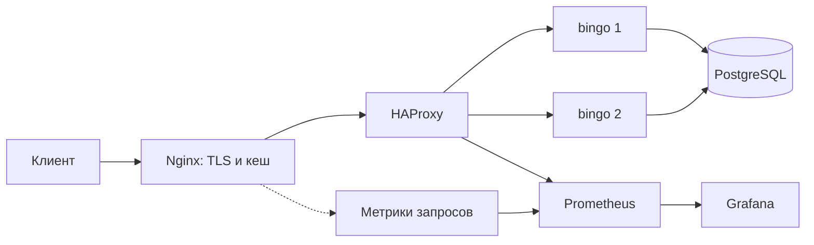

# КиноСфера

Развёртывание готового приложения `bingo`: две реплики, PostgreSQL,
балансировка, HTTPS/HTTP3, кеширование и мониторинг. Установка через Ansible,
сервисы работают в Docker Compose.

## Материалы сдачи

- [Презентация](presentation/КиноСфера-защита.pptx).
- [Комментарии к слайдам: план на 10 минут](presentation/comments.md).
- [Результаты проверок](docs/verification.md).
- Публичный сервис: https://94-41-94-5.sslip.io/ping.

Комментарии также встроены в заметки слайдов. Сертификат сервиса
самоподписанный; проверяющий клиент должен явно ему доверять.

Дедлайн: **13 октября 2026, 11:00 МСК** (13:00 Екатеринбург, 08:00 UTC).
К этому времени код, финальная презентация и комментарии должны быть в `main`.
После дедлайна изменения кода и презентации выполняются в отдельной ветке.
В README основной ветки описываются имя этой ветки и предполагаемые изменения.
История сдачи не переписывается. На момент этой публикации дополнительных
веток с изменениями после дедлайна нет.

## Требования

Ubuntu Server **22.04 x86-64**, 4 vCPU, 8 ГБ RAM, диск от 40 ГБ.
Выделите корневому разделу весь доступный остаток диска. Нужен исходящий
интернет для загрузки пакетов и образов. Включите OpenSSH при установке ОС.

## Установка

Ansible запускается прямо на целевой Ubuntu. Все команды Linux ниже
выполняются от root (`sudo -i`).

### 1. Перенести репозиторий

Скачайте или клонируйте репозиторий на компьютере с доступом к GitHub.
Для закрытого репозитория потребуется авторизация. Если исходники находятся
на Windows, выполните из их каталога в PowerShell:

```powershell
git archive --format=tar.gz --output=kinosfera-source.tar.gz HEAD
scp.exe kinosfera-source.tar.gz USER@SERVER_IP:kinosfera-source.tar.gz
```

Замените `USER` на пользователя Ubuntu, `SERVER_IP` на адрес ВМ.
На Ubuntu после `sudo -i` (в пути укажите того же пользователя):

```bash
mkdir -p /opt/kinosfera-src
tar -xzf /home/USER/kinosfera-source.tar.gz -C /opt/kinosfera-src
cd /opt/kinosfera-src
```

Если исходники уже доступны на Linux, скопируйте их в `/opt/kinosfera-src`.
При входе под root переданный архив находится в `/root`, а не `/home/USER`.

### 2. Установить Ansible

Python 3.12 устанавливается отдельно; системный Python Ubuntu сохраняется.

```bash
apt-get update
apt-get install -y curl ca-certificates python3
install -d -m 700 .state
curl -LsSf https://astral.sh/uv/0.13.0/install.sh -o .state/install-uv.sh
sh .state/install-uv.sh
/root/.local/bin/uv python install 3.12
/root/.local/bin/uv venv --python 3.12 .state/ansible-venv
/root/.local/bin/uv pip install --python .state/ansible-venv/bin/python -r ansible/requirements.txt
```

### 3. Задать параметры и запустить

```bash
cd /opt/kinosfera-src/ansible
cp inventory.example.yml inventory.yml
nano inventory.yml
```

Заполните три значения:

| Параметр | Значение |
| --- | --- |
| `kinosfera_bind_ip` | Реальный LAN-IP Ubuntu |
| `kinosfera_tls_domain` | Домен сервиса без схемы и пути |
| `kinosfera_student_email` | Email студента для бинарника и чекера |

Домен должен указывать на ваш белый IP. Подойдёт собственная A-запись или
имя sslip.io со встроенным IP. По умолчанию создаётся самоподписанный
сертификат; браузер потребует доверия.

```bash
../.state/ansible-venv/bin/ansible-playbook -i inventory.yml site.yml --syntax-check
../.state/ansible-venv/bin/ansible-playbook -i inventory.yml site.yml
```

Playbook установит Docker и Compose, включит NTP, создаст случайные пароли,
заполнит БД, добавит индексы и запустит восемь сервисов в `/opt/kinosfera`.
Первичная загрузка 5 миллионов сессий может занять несколько минут.
Дождитесь `PLAY RECAP` с `failed=0` и `unreachable=0`.

## Проверка

Замените адрес и домен в командах на свои:

```bash
cd /opt/kinosfera
docker compose ps
curl --noproxy '*' -fsS http://192.168.1.50/ping
python3 scripts/verify_project.py 192.168.1.50 --domain bingo.example.com --ca certs/server.crt --smoke
```

У app1, app2 и postgres ожидается `healthy`, `/ping` отвечает `pong`,
итог smoke — `"passed": true`. Ansible также проверяет HTTPS, время
и две цели Prometheus. Повторный запуск неизменённого здорового стенда
ожидается с `changed=0`; пароли и БД сохраняются.

Grafana: `http://LAN_IP:3000/d/kinosfera`, пользователь `admin`, пароль
`GRAFANA_PASSWORD` из `/opt/kinosfera/.env`.

Закрепите LAN-IP в DHCP роутера и пробросьте **TCP 80, TCP 443 и UDP 443**
на Ubuntu. HTTP работает без редиректа. Проверьте `/ping` с мобильной сети,
затем запускайте внешний чекер. `.env` и приватный TLS-ключ в Git не добавляйте.

## Как работает



HAProxy распределяет запросы и проверяет `/ping` каждую секунду.
Нездоровая реплика исключается из балансировки. Watchdog завершает зависший
процесс после трёх неудачных проверок, Docker запускает контейнер снова.
GET/HEAD могут повторяться на другой реплике при ошибках; ответы POST/DELETE
автоматически не переигрываются.

Nginx обслуживает HTTP, HTTPS и HTTP/3. Только `/long_dummy` кешируется на
50 секунд; остальные API идут в приложение. Alt-Svc сообщает о HTTP/3,
для реальной работы которого нужен доступный UDP 443.

PostgreSQL хранит данные в Docker volume. Prometheus собирает метрики,
Grafana показывает RPS, ошибки и задержки. Все сервисы находятся на одной
машине: схема защищает от отказа реплики приложения, но не хоста или общей БД.

Дополнительно: [Ansible по SSH](ansible/README.md),
[эксплуатация и проверки](docs/operations.md).
